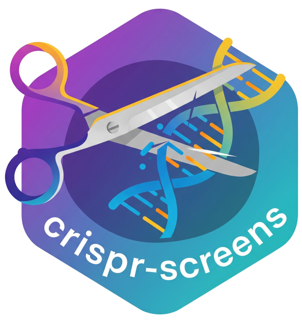

# Snakemake workflow: `crispr-screens`

[](https://doi.org/10.5281/zenodo.10286661)
[](https://snakemake.github.io)
[](https://github.com/niekwit/crispr-screens/actions/workflows/main.yml)

<p align="center">
  
</p>

A Snakemake workflow for the analysis of CRISPR screens.

If you use this workflow in a paper, don't forget to give credits to the authors by citing the following paper:

> Pauzaite, T., Wit, N., Seear, R.V. et al. Deubiquitinating enzyme mutagenesis screens identify a USP43-dependent HIF-1 transcriptional response. EMBO J 43, 8 (2024). https://doi.org/10.1038/s44318-024-00166-6

## Quick start

1. Install Snakemake (≥ 8.25.5) and [snakefetch](https://pypi.org/project/snakefetch/):

   ```shell
   conda create -n snakemake bioconda::snakemake=8.25.5
   conda activate snakemake
   pip install snakefetch
   ```

2. Download the workflow code and default config into a new analysis directory (see the [releases](https://github.com/niekwit/crispr-screens/releases) for the latest version):

   ```shell
   mkdir my_experiment && cd my_experiment
   snakefetch --outdir . --repo-version v1.2.0 --url https://github.com/niekwit/crispr-screens
   ```

3. Add your data:
   - `reads/`: one `.fastq.gz` (or `.cram`) file per sample
   - `resources/`: the sgRNA library as a CSV file with sgRNA names, gene names and sequences
   - `config/config.yml`: library path and columns, and which analyses to run (MAGeCK, DrugZ, BAGEL2, STRING-db)
   - `config/stats.csv`: the comparisons to make, with `test` and `control` columns (sample names without file extension; separate replicates with `;`)

4. Check the run with a dry run, then run the workflow:

   ```shell
   snakemake -n
   snakemake --use-conda --cores 8
   ```

   Add `--use-apptainer` to run everything in the workflow's prebuilt container.

The main outputs are `results/qc-report.html` (sample QC) and `results/interactive_report.html` (MAGeCK, DrugZ and BAGEL2 results).

Further instructions on how to use `crispr-screens` can be found here:

https://crispr-screens.readthedocs.io/en/latest/
